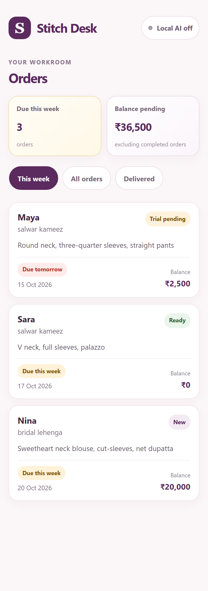
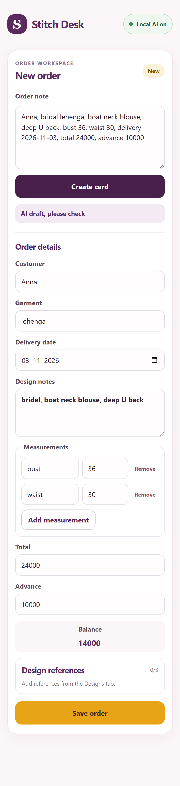
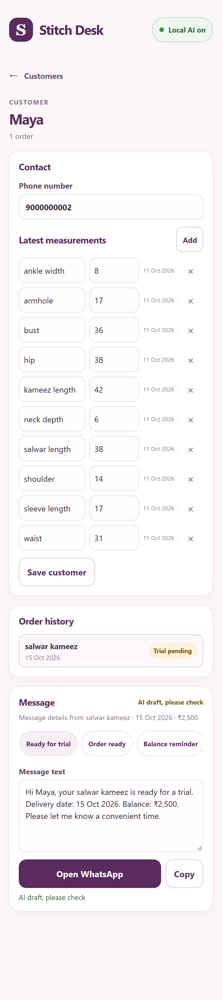
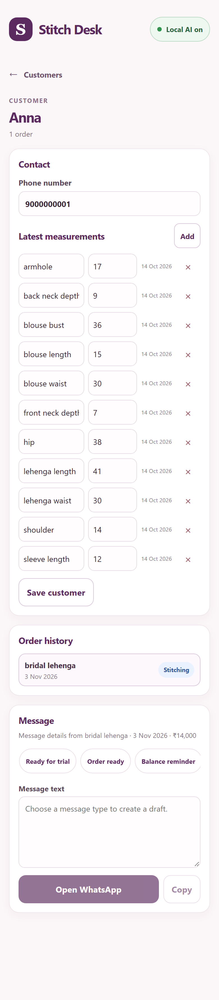
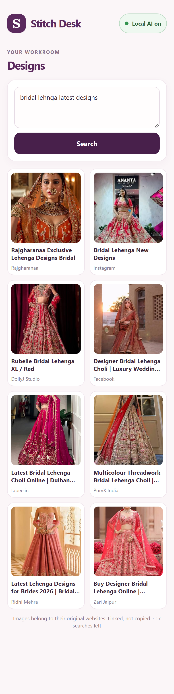

# Stitch Desk

Stitch Desk is a local-first order assistant for boutiques and tailors: turn a messy customer note into an editable order card, keep customer contact details and measurements together with WhatsApp message drafts, and search for outfit design pictures to link as order references.

## Features

- Create order cards from a pasted note with local AI, or fill the order in by hand.
- Track delivery dates, order status, advances, balances, and design references.
- Group saved orders by customer, save contact numbers and measurements, and create editable WhatsApp message drafts.
- Search Google Images through SerpApi and attach up to three linked design references to an order.
- Keep orders, customer details, and in-progress order drafts in this browser's local storage.

## Who it's for

Stitch Desk is for small boutiques and tailors who keep orders, measurements, and delivery dates in notebooks and WhatsApp chats. They get a quick way to turn a spoken or typed note into a clean order card, see what is due this week and what balance is pending, and send a polite message to a customer, without sending customer records to a hosted AI service.

## My First User

I showed Stitch Desk to a tailor near me. They haven't used it on real orders yet, so this is a first reaction and not a full test.

- **First reaction:** "This looks useful. If I can manage customer measurements and stitching orders in one place, it could save me time."
- **What they liked:** Storing customer measurements, tracking order status, and keeping track of delivery dates without relying on notebooks.
- **What they'd change:** No suggestions yet.

## Why open-source AI

Gemma runs locally through Ollama, so there is no per-order AI cost. Customer notes and measurements stay on the owner's device instead of being sent to a hosted AI service. The model can be swapped by changing the `MODEL_NAME` setting in `src/ai/gemma.js`.

## Tech stack

- React
- Vite
- Node.js and Express
- Ollama with Gemma
- SerpApi Google Images
- Browser `localStorage`

## Setup

1. Install Node.js.
2. Install [Ollama](https://ollama.com/) and start it.
3. Download the model:

   ```sh
   ollama pull gemma3:4b
   ```

4. Copy `.env.example` to `.env` and add your SerpApi key as `SERPAPI_KEY`.
5. Install dependencies and start the Vite app and API server:

   ```sh
   npm install
   npm run dev:all
   ```

6. Open the local URL printed by Vite.

## How the AI is used

- **Order cards:** Gemma extracts customer, garment, design notes, measurements, delivery date, total, and advance from the owner's note.
- **Message wording:** Gemma rewrites one of the built-in message templates in a short, polite tone.
- **Search queries:** Gemma creates short outfit-design search terms; those terms are sent to the local design-search API and then to SerpApi.

AI output is shown to the owner for review before use. Message numbers and dates are checked in code, and generated search queries are checked in code to remove digits, saved customer-name words, and measurement or payment terms. If Ollama is off or output is unusable, order entry falls back to manual entry and message writing uses the plain template.

## Privacy

Orders, customer details, measurements, and order drafts are stored in this browser's `localStorage`. The app sends design-search words to SerpApi, not order records; generated queries are checked to remove saved customer names, digits, and measurement/payment terms. SerpApi search results include links and remote thumbnails from their original websites.

## Known limitations

- Ollama must be running on the owner's computer for AI-assisted actions.
- The small local model can make mistakes with numbers; review every AI draft.
- Image searches are limited by the account's SerpApi plan and the app's per-run search limit.
- Data is only in one browser and there is no backup yet.
- The app has been tested on a small number of notes.
- Accessing Ollama from a phone on the local network may require configuring Ollama's allowed origins.

## What's next

- Add backups and a way to move data between browsers.
- Test more order-note styles and additional devices.
- Expand order and customer workflows based on tailor feedback.

## Screenshots

Screenshots use fictional sample data.

To regenerate the screenshots, start the app and API with `npm run dev:all` and run `npm run screenshots` in another terminal. Set `BASE_URL` if the app is running at a different URL. The Designs screenshot is skipped unless the API server and `SERPAPI_KEY` are available.

### Orders



### New order



### Customer details





### Design search



Images in the Designs search belong to their original websites and are linked, not copied.

**Built for:** DEV Hacktoberfest Open-Source AI Challenge: Week 2 (Side Hustle)
